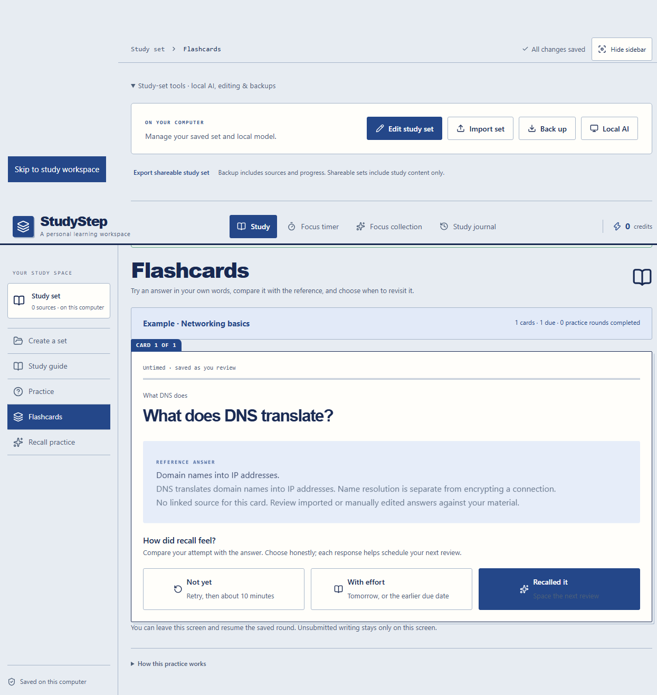

# StudyStep

StudyStep turns your own notes into source-linked study guides, flashcards and practice questions. Its Windows desktop app stores study progress locally.

[Download the latest published Windows release](https://github.com/seaboose/StudyStep/releases/latest) · [Release notes for 0.4.0](docs/release-0.4.0.md)

Extract the whole ZIP, then open **StudyStep.exe**. The app is unsigned. Manual study works offline. Wikipedia features need internet. Optional AI drafting uses a separately installed local Ollama model.

## Learn with StudyStep

- Import PDF, DOCX, Markdown or text, or start with a topic overview.
- Review source-linked questions and flashcards. After practice, choose a suggested activity, inspect the evidence behind the recommendation, or correct your topic assessment.
- Follow Wikipedia introductions at a daily, weekly or 30-day interval. Review changed wording while the app is open or when it next starts.
- Discover related readings with a reason and a prerequisite. Accept them into your reading list or dismiss them for that study set.
- Time a focus session, pause and resume it, and export the journal.
- Inspect and approve optional local AI drafts before adding them. Generated content still needs learner judgment.

[Build and test](docs/development.md) · [Security](SECURITY.md) · [Dependency notices](THIRD_PARTY_NOTICES.txt)
