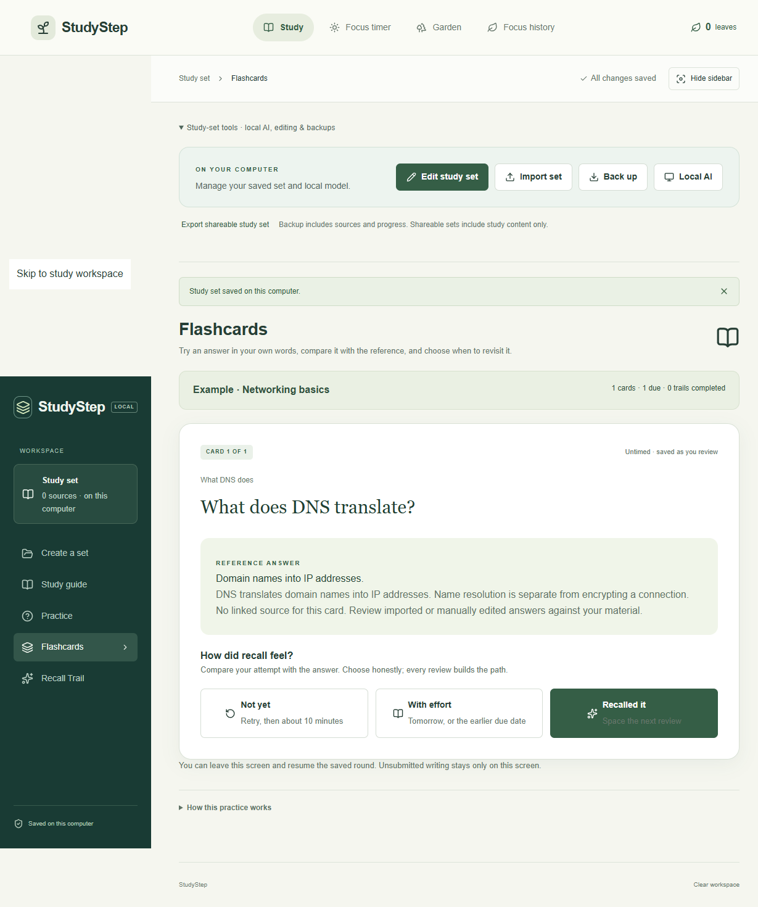

# StudyStep

[](https://github.com/seaboose/StudyStep/actions/workflows/checks.yml)

I built StudyStep to turn my notes into manageable practice and check answers against their sources. It is a local Windows study app built with React, TypeScript, Node.js, and Electron.

**[Download StudyStep 0.3.0 for Windows](https://github.com/seaboose/StudyStep/releases/latest)** — extract the complete ZIP and open `StudyStep.exe`. No Node.js installation is needed. The app is unsigned.



- Import PDF, DOCX, TXT, or Markdown notes; create source-linked study guides and cards.
- Practice with flashcards, multiple-choice questions, scheduled review, and a focus timer.
- Recover drafts, detect conflicting saves, and export study progress.
- Create sets manually or use optional [Ollama](https://ollama.com/download) generation on this computer. Models are not bundled.

## Quickstart

Use Node.js 24 and pnpm 11.25.0:

```sh
pnpm install --frozen-lockfile
pnpm --dir desktop install --frozen-lockfile
pnpm build
pnpm desktop
```

Use `pnpm start` for browser mode. On Windows, `pnpm desktop:package` creates an unsigned standalone app under `desktop/releases/`; keep its complete folder together.

For generation, install a local Ollama model, keep Ollama at `127.0.0.1:11434`, and select it in StudyStep. Manual study works without it.

## Checks

```sh
pnpm typecheck
pnpm build
pnpm test
```

The Windows desktop check is `node tests/desktop-smoke.mjs`. Tests cover validation, scoring, recovery, persistence, scheduling, and request boundaries. Model fixtures do not establish real-model accuracy.

## Code map

| Location | Purpose |
| --- | --- |
| `app/`, `local/` | Study views and local application |
| `lib/` | Document extraction, validation, practice and review logic |
| `scripts/` | Local server, persistence and model integration |
| `desktop/` | Electron application and Windows packaging |
| `tests/` | Logic, API and desktop checks |
| `examples/` | Small networking study set |

## Limits and privacy

Generated drafts receive quotation and model-review checks, but can still be wrong. Review important answers yourself. Recall ratings do not prove mastery or complete course coverage.

Data stays local except optional Wikipedia search queries. Local files are unencrypted. For a complete backup, close the app and copy the folder opened by **StudyStep → Open local data folder**; browser mode uses `.local-data/`.

See [security and data limits](SECURITY.md), [contribution guidance](CONTRIBUTING.md), and [third-party notices](THIRD_PARTY_NOTICES.txt). MIT licensed.
