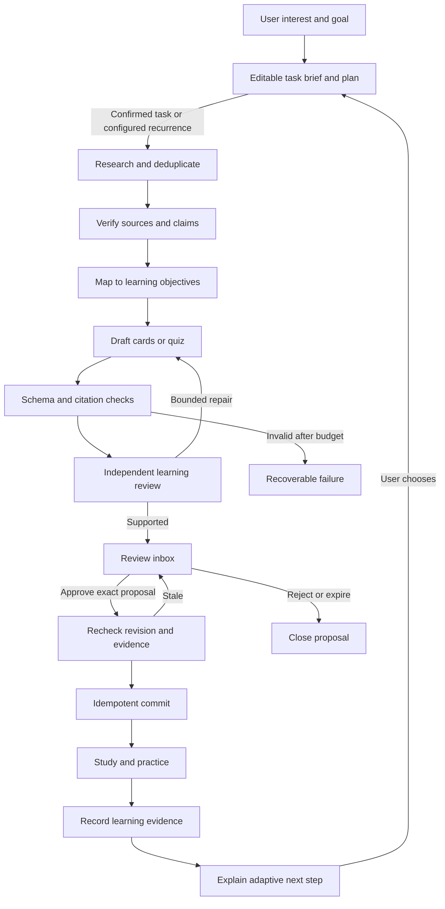

# StudyStep personal learning agents

Status: target architecture, October 29, 2026. A first Dev implementation now supports explicit topic/goal tasks, Wikipedia or selected-source research, reviewed card/quiz proposals, approval, and progress-based next steps. See [the runnable Dev guide](agents-dev.md) for its actual scope and limits. The broader architecture below remains a roadmap; schedules, Slack, paid models, and automatic code changes are not active.

Current Dev functionality adds the first Learning agents screen to the existing study tools. A full editable learner profile, concept graph, monitoring schedules, and the Python sidecar below remain future work. The focus collection is decorative and does not determine difficulty.

## The product experience

StudyStep is a personal learning application for the subjects the user chooses. The user gives agents a goal; the agents research that subject, maintain useful study material, identify relevant developments, and recommend the next appropriate challenge. They build a revisable understanding of the user's learning from explicit preferences and observed practice. Cybersecurity can be one interest alongside mathematics, history, design, languages, or anything else; it is not the product's identity or default curriculum.

Surge informs the visual signature: dark panels, cyan accents, typography, compact controls, and readable status states. StudyStep keeps its own learning-centered navigation and interaction flow. A progress visualization represents accumulated study effort; it does not certify knowledge or determine difficulty by itself.

The proposed journey is **Choose an interest and goal → Task agents → Review a plan and evidence → Study and practice → Get an adaptive next step**. A returning user can also ask a bounded question such as “Keep me current on this topic,” “Build on what I already know,” or “Help me understand where I went wrong.” A daily brief is optional, not the mandatory home screen for every subject.

The user should see useful outputs, not agent chatter:

- **My topics:** interests, goals, current learning plans, accepted study sets, and the next suggested action for each topic.
- **Task agents:** choose a topic, desired outcome, starting level or uncertainty, available study time, difficulty preference, source preferences, and one-time or recurring cadence. Natural-language requests become an editable structured task brief before work is committed.
- **Plan preview:** the proposed scope, prerequisites, source approach, outputs, cadence, and resource bound. A confirmed task starts the job; changed scope or newly recurring work requires a revised plan.
- **Topic workspace:** source-linked explanations, accepted cards, practice, and optional “What changed?” updates in the same subject. Show why a recommendation matters to the selected goal.
- **Review inbox:** proposed additions, corrections, and harder material with before/after differences, source excerpts, and Accept/Edit/Reject controls. Keep existing cards and review history intact.
- **Practice:** a three-to-five-question check matched to accepted learning objectives, with explanations and honest distinction between unaided, hinted, and revealed answers.
- **Next steps:** reinforce a weak prerequisite, apply an understood concept in a new example, or attempt a harder problem. Include the evidence behind that suggestion and let the user choose a different level.
- **Learning profile:** editable goals and preferences; observed practice evidence; tentative knowledge estimates with confidence and age. Let the user correct or forget an inference, pause personalization, and export or delete retained learning records through explicit controls.
- **Agent activity:** queued/running/waiting-review results, sources used, recoverable failures, and resource usage. Pause or cancel a task and change its cadence without needing to inspect internal agent conversations.
- **Developer workspace:** maintenance findings, visual previews, test results, and reviewable patches. Everyday study does not need to expose these controls.

## Two agent teams and one deterministic coordinator

Agents are bounded roles with separate prompts, state contracts, and tool grants. They may share a model; a separate model process per role is unnecessary. The coordinator controls the graph and permissions in code rather than trusting a manager model to authorize actions.

| Role | Individual job | Typed output | Tools and authority |
| --- | --- | --- | --- |
| Subject Researcher | Research the user's assigned question or goal; locate suitable primary/reference sources and record what remains uncertain. | `ResearchBundle` | Scoped public fetch broker, selected imported sources, source cache; no accepted study-set writes. |
| Evidence Analyst | Verify each teaching claim against source passages; flag contradictions, scope limits, and unsuitable source levels. | `EvidenceBundle` | Read source snapshots and catalog; no publishing or approvals. |
| Update Scout | Recheck the sources configured for a topic and explain meaningful changes since the prior accepted snapshot. | `TopicUpdate[]` | Topic-scoped source list and cache; cannot subscribe to new feeds, change cadence, or rewrite cards by itself. |
| Discovery Agent | Find useful adjacent concepts or new work within the user's interest, with evidence, relevance, and prerequisites. | `TopicProposal[]` | Read evidence and the selected topic map; propose, rather than silently expand, the curriculum. |
| Curriculum Planner | Turn the goal, prerequisites, and learning evidence into a manageable sequence and an appropriately harder next activity. | `LearningPlan`, `NextStepProposal` | Read the permitted learning profile and accepted material; cannot alter user goals or declare mastery. |
| Card Author | Draft a small set of precise cards, explanations, and candidate distractors. | `CardProposal[]` | Read assigned evidence and existing cards for deduplication; write proposals only. |
| Quiz Coach | Select due or weak concepts and assemble short checks; explain answers with citations. | `QuizDraft`, `FeedbackDraft` | Read accepted cards and answer records; cannot mark its own question valid. |
| Learner Modeler | Summarize topic-specific strengths, gaps, and uncertainty from practice evidence; propose profile updates with evidence references. | `LearnerProfileProposal` | Read consented task preferences and learning events; no unrelated files, hidden personality profiling, or unsupported diagnoses. |
| Learning Reviewer | Independently solve every question, check all choices and source support, and flag ambiguity or duplicate concepts. | `ReviewVerdict` | Read evidence and draft; no answer key for its initial solve; cannot approve for the human. |
| Reliability Maintainer | Triage reproducible errors, dependency advisories, and cancellation/restart failures; propose repairs. | `MaintenanceIssue`, `PatchProposal` | Redacted diagnostics and an isolated checkout; no production app/data writes. |
| Experience Reviewer | Check learning flow, keyboard access, contrast, responsive layouts, and StudyStep's visual system; propose changes with screenshots. | `UXFinding[]`, `PatchProposal` | Test fixture workspace and screenshot artifacts; no personal study-note capture. |
| Code Reviewer | Review maintenance diffs and test evidence independently, including security and migration risks. | `CodeReviewVerdict` | Read branch diff and test output; no self-approval, merge, or deployment authority. |

Deterministic services handle scheduling, content deduplication, token counting, budget reservations, persistence, schema validation, permission checks, and accepted-data commits. These do not need LLM calls.

Each task grants only the roles and tools needed for its outcome. “Explain this chapter” need not dispatch an Update Scout, and a mathematics refresher need not fetch daily news. The maintenance team improves the application independently of the learning team; it cannot inspect private study material by default.

## Runtime and typed boundary

Keep Electron/React and the existing Node study service. Add a packaged **FastAPI + asyncio + Pydantic + LangGraph** sidecar for agent jobs. Electron owns its lifecycle. Bind it to a dynamically allocated loopback port; use a per-launch authentication token passed through a private parent/child channel, never a renderer URL or log. The renderer talks through the existing app backend, which enforces origin/host and request-size checks.

Use strict Pydantic models with forbidden extra fields at every boundary. Validate semantic rules as well as field types. Export versioned JSON Schemas for matching TypeScript/Zod clients. A JSON object passing its schema does not establish truth or permission. [Pydantic strict mode](https://pydantic.dev/docs/validation/latest/concepts/strict_mode/)

| Contract | Required contents |
| --- | --- |
| `LearningTask` | Topic and goal; allowed scope; starting-level statement; available time; difficulty preference; approved source policy; output types; cadence and time zone; plan revision; resource limits; personalization permission. |
| `RunState` | Schema version; run ID; workflow type/version; node; status; source snapshot IDs; workspace revision; proposal IDs; per-node attempts; cancellation; budget reservations; trace ID; checkpoint version. |
| `EvidenceItem` | Stable source ID; canonical URL; publisher; published/updated/fetched timestamps; content hash; excerpt and location; supported claim IDs; expiry/revalidation policy. |
| `CardProposal` | Proposal ID; target set; base revision and content hash; add/update operation; proposed card; citations; objective; deduplication result; review verdict. |
| `ReviewVerdict` | Exact item IDs; supported/unsupported/uncertain; independently selected answer; per-option checks; issue codes; evidence references. |
| `LearningEvent` | Concept and item versions; prompt version; answer; score/rubric version; hint/reveal use; attempt; timestamp; self-reported confidence when offered; provenance. Do not infer attention or ability from idle time alone. |
| `LearnerProfileProposal` | Topic/concept; observation or estimate; supporting event IDs; confidence; uncertainty; expiry/reassessment date; user correction status; reason for the change. Explicit preferences and inferred estimates remain separate. |
| `NextStepProposal` | Target objective; prerequisites; challenge level; evidence for readiness; explanation; fallback review; estimated workload; user choice and plan revision. |
| `Approval` | Proposal hash; target and base revision; approver; decision; expiry; consumed timestamp; idempotency key. |
| `ToolResult` | Tool name/version; request ID; status; validated payload; safe error code; retryability; elapsed time; resource charge. |
| `PatchProposal` | Base commit; isolated branch; changed files; rationale; test commands/results; screenshots when relevant; reviewer verdict. |

Free-form prose is permitted inside bounded fields such as explanations, never as an executable handoff. Source text cannot supply routing instructions, tool grants, shell commands, or approval state. No model receives raw credentials.

Suggested API: `POST /agent-runs` returns a run ID; `GET /agent-runs/{id}` returns status; an authenticated event stream reports progress; cancel, review, and approval endpoints are explicit commands. Duplicate submissions carry an idempotency key. The Python service owns run/proposal state; the existing Node service remains the sole writer of accepted study data during the first release.

Use SQLite on the local machine for job leases, proposals, checkpoints, approvals, and a durable event outbox. Do not put the active database in the synced source directory. Persist node results and external-effect receipts before acknowledging completion. Checkpoint recovery must survive app restart; an in-memory saver cannot do that. [LangGraph persistence](https://docs.langchain.com/oss/python/langgraph/persistence)

## Study workflow

The quiz selection path can present already accepted cards immediately. Newly generated questions must pass content review first and be identified as draft material until accepted. Answer scoring records the actual user action; revealed/hinted answers retain their current treatment and do not count as independent correct recall.

Never silently replace a study set. A proposal shows additions, corrections, affected review schedules, and citations. On acceptance, recheck the stored revision and hash, then commit only the reviewed changes. Preserve untouched cards and progress. Edits to a proposal invalidate its prior review and approval. A stale accepted card can be flagged with a proposed correction; its text and history remain available until the user acts.

Model retries are node-specific: maximum **three repair retries after the initial attempt**, within the run's global call/time/token limits. Pass bounded, redacted validation issues to the author. Retry a transient read with backoff; do not replay a write with unknown outcome until its receipt/idempotency status is checked. Cancellation and denied permissions are not model-repair prompts.

## Evidence and emerging topics

Choose sources for the subject and task: user-selected course notes, textbooks/reference material, original research, official documentation, or suitable primary archives. The task's source policy records which are allowed and their purpose. A stable foundational topic may need occasional source checks; a changing topic may benefit from regular updates. Update Scout remains idle unless the user has requested monitoring. Cybersecurity sources such as CISA are a possible topic configuration, not a universal feed.

Keep each fetched snapshot's hash and acquisition time. Treat news coverage as discovery material and follow it to the underlying technical or scholarly source before teaching a claim. Distinguish established explanation, new finding, contested interpretation, and preliminary evidence. When sources disagree, show the disagreement rather than inventing a single definitive answer.

Rank developments by relevance to selected subjects, new evidence, repeated independent observations, and actionable learning value. Deduplicate syndication by canonical source and content hash; ten reposts are not ten confirmations. Separate the date an event occurred from when an article was published or updated. Present conflicting or incomplete claims as uncertain and keep them out of scored questions.

For example, a user studying statistics could ask for a sequence from conditional probability to interpreting a research result. The researcher assembles sources, the planner checks prerequisites, the author drafts worked examples and questions, and the reviewer verifies the result. If a newly published study is relevant, the update explains which concepts help interpret it instead of substituting headlines for learning. For a history topic, a new source might produce an annotated comparison of interpretations rather than a single-answer quiz.

Use exact cited passages for supported answers, test every distractor for overlap, and reject unsupported generalizations. An independent reviewer is an additional check, not proof of correctness. The user can open the underlying source from every new card.

## Learning the user and increasing challenge

Keep three kinds of information distinct: **stated preferences** (goals, time, language, preferred formats), **observations** (what the user answered, with which hints, on which concept and item version), and **estimates** (a tentative concept-level readiness assessment). A model-generated summary cannot change the observation record. Goals and stated preferences change through the user; a Learner Modeler can only propose evidence-linked estimates within the enabled personalization scope.

The profile is topic-specific. A strong algebra result does not establish readiness in another field. Do not infer personality, diagnosis, motivation, or general intelligence. Repeated exposure to the same answer, time in the app, focus credits, and a revealed answer are not evidence of independent mastery. Missing data means uncertainty, not weakness.

Use a visible, versioned progression policy. An initial engineering policy can require several distinct unaided checks across more than one session, plus prerequisite coverage, before proposing a higher challenge level. The exact threshold must be calibrated with evaluation data; it is not a validated claim about learning. Confidence decreases when evidence is sparse, old, conflicting, or tied to poorly reviewed questions. A user can choose a harder challenge directly without the system presenting that choice as demonstrated readiness.

Raise difficulty along an explicit dimension: recall → explanation → application in a new example → transfer or synthesis. Do not merely lengthen wording or add obscure facts. The next-step proposal identifies its target concept, prerequisite evidence, change in difficulty, and an easier alternative. One poor result should lead to a useful explanation and a choice to reinforce a prerequisite, not an unexplained permanent downgrade.

Example: after distinct successful unaided questions on conditional probability, suggest a new-context problem and explain why. If hints were needed, offer a short worked example and a later check before increasing the challenge. The independent reviewer verifies new material and its rubric before presentation; the user's actual actions remain the source of scoring evidence.

Show “Why this next?” and allow **Keep this level**, **Make it harder**, **Review foundations**, and **Change goal**. Profile controls expose evidence behind an inference and support correction, forgetting, or pausing personalization. Forgetting an inference marks it suppressed so the next summary does not immediately recreate it from the same records; deleting underlying events is a separate explicit action. Changes to this state invalidate dependent recommendations and cached profile summaries. Export/import and removal behavior must be covered by tests.

## Scheduling proposal

These are proposed options, not installed schedules. A task defaults to one run. Recurrence is configured per topic by the user and follows the chosen local time zone with daylight-saving handling.

| Job | Proposed trigger | Bound and notification |
| --- | --- | --- |
| Subject Researcher | User confirms a task or asks a new scoped question | Bounded source pool and outputs; show evidence gaps instead of silently broadening the task. |
| Update Scout | User-selected cadence, such as weekly; app-open catch-up if enabled | Up to 20 source changes, at most 5 relevant updates. Notify only for a meaningful change. Stable subjects need not produce news. |
| Discovery Agent | User asks for extensions; optional weekly topic review | At most 3 adjacent or emerging-topic proposals with evidence, relevance, and prerequisites. |
| Quiz Coach | User starts practice; optional daily reminder | 3–5 questions, usually due/weak material, with at most one new topic. |
| Card Author | User chooses “Practice this” or accepts a topic plan | At most 5 proposed cards per run; batch into one review inbox item. |
| Learner Modeler and Curriculum Planner | After a completed practice session or a user goal/profile correction | Coalesce observations into one explained next-step proposal; no notification for every answer. |
| Reliability Maintainer | Repeated redacted error signature; weekly dependency check | One deduplicated issue per failure; no repeated “still failing” notifications. |
| Experience Reviewer | A UI-related branch or release candidate | Fixture-based visual/keyboard checks and concrete findings. |
| Memory cleanup | Once per day while runtime is available | Quiet unless corruption or a required decision is detected. |

A closed desktop app cannot execute jobs. Initially, catch up once on the next launch and coalesce missed runs. An optional Windows background worker or hosted scheduler is a later deployment choice; creating it requires a separate setup step, clear status, a stop control, and the same budget limits. Do not wake the PC or install a startup service implicitly.

## Resource limits and recovery

- Support **100+ concurrent orchestration requests** in a controlled load test; start local model inference with one worker and a bounded queue. Use separate semaphores for fetches and inference, admission limits, backpressure, cancellation, and fair scheduling. Background topic updates must not starve an active quiz. Blocking extraction/embedding work belongs in a worker process. `while True` is not inherently blocking if it awaits; unbounded busy loops and blocking I/O are the actual issue. [FastAPI concurrency](https://fastapi.tiangolo.com/async/)
- Before every call, count the full system/task/schema/evidence/chat overhead with the selected model's tokenizer and reserve output capacity plus margin. Drop lowest-priority retrieved evidence first; never truncate permission instructions or JSON schemas. Fail clearly if the minimum request cannot fit. The current 12,000-character selection limit is not a full token budget.
- Proposed per-run limits: 12 model calls, 10 minutes, three repairs per failing node, and a bounded evidence pool. Tune these with measurements; recovery cannot reset the budget ledger.
- If hosted inference is later enabled, reserve worst-case next-call spend atomically using a pinned pricing version and integer microdollars. **$0.50 is a hard total run ceiling**, including concurrent calls and retries. Select a cheaper model only before dispatch and only if its reservation fits; otherwise stop and preserve the draft. Unknown pricing or usage fails closed for further paid calls. Local inference still has time/token/concurrency limits.
- Persist job leases; reclaim expired leases after restart. Resume from verified checkpoints, not by restarting every completed tool call. Expose queued/running/waiting-review/failed/cancelled states and a useful next action. An unavailable model leaves manual study operational.
- Cancel/stop-all controls revoke queued work and propagate cancellation to active calls. A daily aggregate cap and a maximum queue length prevent many individually cheap jobs from becoming a large bill.

## Three memory tiers

1. **Working:** per-run evidence and scratch state; expire 24 hours after a terminal result, with a byte ceiling. Keep required pending-approval state until expiry.
2. **Episodic:** concise session summaries and learning observations with provenance; suggested 30-day retention. A model's summary cannot replace actual answer/reveal records.
3. **Semantic:** source passages and accepted concept links in a local vector index. Rank by relevance, authority, recency, and diversity; use stable source IDs and filter by owner/workspace. Revalidate time-sensitive sources; delete obsolete embeddings when their source is removed.

Accepted study sets, user goals, observations, and their citations are durable user data, not a TTL cache. Eviction must preserve their referenced evidence or keep an explicit archived snapshot. Derived learner estimates have their own reassessment dates and can be corrected or forgotten without rewriting historical answers. TTLs and byte ceilings apply to disposable caches/checkpoints; provide review/export controls for retained history. Memory from external topic research and maintenance jobs is partitioned from private learning records; roles receive only the minimum relevant profile fields.

## Approval that can wait three days

Use an in-app durable approval first. Persist the exact draft hash, revision, action, approver identity, expiry (72 hours), and consumption status; checkpoint the graph and release its worker. Restart can resume that approval; expiry is not consent. LangGraph interrupts supply a pause/resume primitive but still need a durable checkpointer and idempotent effects. [LangGraph interrupts](https://docs.langchain.com/oss/python/langgraph/interrupts)

Slack is an optional adapter to the same approval record. An outgoing notification webhook alone cannot receive button approval; configure interactivity with a reachable HTTPS handler or a separately designed connection mechanism. Validate Slack's request signature and timestamp, authorize the user/workspace, deduplicate the action, and acknowledge the interaction promptly. The callback queues a resume command; it does not hold an HTTP request open for days. A sleeping local app needs durable relay storage or approval waits until it reconnects. [Slack request verification](https://docs.slack.dev/authentication/verifying-requests-from-slack/), [Slack interaction handling](https://docs.slack.dev/interactivity/handling-user-interaction/)

## Maintenance and visual-flow work

Maintenance runs use a separate graph: **Reproduce → Specify fix → Patch isolated branch → Test → Independent code/UX review → Human merge/release decision**. Give the coding role an allowlisted checkout and fixture data, never the installed application's directory, personal study database, model credentials, or arbitrary host access.

The reliability role submits a sanitized stack trace, reproduction, affected version, and expected behavior. The coding role makes a bounded patch on one issue. The experience role supplies before/after screenshots, keyboard traversal, portrait/wide viewport checks, and readable empty/error/loading states. The code reviewer verifies both implementation and test evidence. Tests must run in a disposable environment with controlled dependency/network access.

A passed branch becomes a reviewable patch or draft PR; it does not replace the running product. Do not grant an agent authority to merge its own patch, change the rules that constrain it, disable CI, access secrets, or publish a release. A rollback-capable, versioned release with data compatibility checks is the final approved step. StudyStep Dev is where changes are previewed.

## Security, tracing, and evaluations

Treat imported documents, fetched pages, agent messages, tool responses, and stored memories as untrusted content. Keep source text in data fields, validate every handoff, restrict each role's tools, and require authorization at the tool broker. A “strip malicious instructions” filter cannot guarantee injection resistance; retain original evidence privately and render sanitized display text. Test encoded/indirect injections, poisoned citations, unauthorized tool requests, and cross-workspace retrieval. [OWASP prompt injection prevention](https://cheatsheetseries.owasp.org/cheatsheets/LLM_Prompt_Injection_Prevention_Cheat_Sheet.html)

Create a run span with child spans for fetch/retrieve/model/tool/review/approval/commit. Record node/version, input/output token counts, reservations/actual costs, latency, safe errors, and before/after state hashes. Content capture is opt-in and redacted; diagnostic traces should not automatically export private notes. Support a local trace view first, with an optional OTLP exporter for a configured backend. [OpenTelemetry GenAI conventions](https://github.com/open-telemetry/semantic-conventions-genai)

CI replays at least 100 seeded trajectories with mock tool/model responses. Validate allowed graph edges and invariants, including required review before commit, exact approval hash, no tools outside role grants, bounded repairs, budget admission, cancellation, stale revision handling, duplicate Slack approval, restart recovery, and no write from a shadow run. Learning cases include hinted-answer handling, sparse/stale profile evidence, forgotten inferences, prerequisite gaps, user difficulty overrides, and prevention of unrelated-topic recommendations. A valid alternative branch is not a failure merely because the linear call order differs. Measure real-model answer support, ambiguity, subject coverage, and challenge appropriateness on a separate, versioned corpus. Improved scores on repeated prompts alone are not proof of learning transfer.

Shadow mode mirrors 5% of eligible inputs to a separate read-only state store with a strict resource cap. Use recorded tool observations where possible. Never issue real write tools, notifications, purchases, or study commits. Compare accepted/rejected cards, evidence coverage, path, latency, and cost. On a single local GPU, defer shadow jobs until idle; the sampling percentage is a rollout setting, not permission to slow practice.

## Mapping all fifteen requested projects

| # | Original project | Concrete StudyStep delivery |
| --- | --- | --- |
| 1 | Async Agent Orchestrator | FastAPI job API, asyncio workers, cancellation, bounded queues, 100-request load test. |
| 2 | Dynamic Context Budget Assembler | Full prompt/schema/retrieval/output ledger per node and selected model. |
| 3 | Strict Pydantic Tool Router | Role allowlist, strict arguments/results, semantic validation, bounded error feedback. |
| 4 | Three-tier Memory & Eviction | Per-run cache, session summaries, source vectors with provenance, TTLs and byte limits; durable learner observations separate from revisable estimates. |
| 5 | Self-Healing ReAct Loop | Three repair retries for safe recoverable failures; redacted errors, total-run limits, no blind write replay. |
| 6 | Typed Multi-Agent Swarm | User-tasked research, learning, and adaptive-planning graph plus a separate maintenance graph; versioned structured state and capabilities. |
| 7 | Async HITL Slack Gate | Durable 72-hour in-app approval, then an optional signed Slack interactivity adapter. |
| 8 | Trajectory Eval CI Gate | 100 replay cases against allowed graph transitions and safety/correctness invariants. |
| 9 | OpenTelemetry Agent Tracer | Run/node/model/tool spans and an opt-in exporter; redacted local replay evidence. |
| 10 | Inter-Agent Sanitization Proxy | Typed broker, source/data separation, output validation, permission checks, injection corpus. |
| 11 | Sandboxed Code Executor | Later: coding exercises and bounded agent-generated tests in an isolated executor with enforced no egress, no credentials, time/memory limits, and disposable storage. Choose an E2B microVM or a properly configured gVisor environment and verify the isolation; they are not interchangeable labels for the same primitive. |
| 12 | Cost Kill-Switch | Atomic pre-dispatch reservation, $0.50 per-run ceiling if paid calls are enabled, aggregate cap and stop-all. |
| 13 | API-to-Browser Fallback | Later: read-only topic-source retrieval from allowlisted sites after API failure; authenticated course portals require a separately scoped integration. Never duplicate an uncertain write through the browser. |
| 14 | Shadow Trajectory Comparator | 5% eligible sampling, replayed observations, separate state, no side effects, idle-only local scheduling. |
| 15 | Public Architecture Teardown | Three reviewed articles: typed learning graph; permission/approval design; measured evaluation/latency/cost results. Publish only after real measurements exist. |

## Implementation milestones and acceptance

1. **Foundation and task brief:** editable topic/goal/source/difficulty/cadence contracts; sidecar packaging/lifecycle; persistent job state; token and resource budgets; cancellation; trace metadata. Acceptance: 100 mock concurrent requests remain responsive, duplicate requests are idempotent, restart recovery works, and a task cannot silently become recurring or expand to unrelated topics.
2. **First complete learning run:** user assigns a topic and goal; Subject Researcher, Evidence Analyst, Card Author, and Learning Reviewer produce a reviewed proposal; the user accepts it and practices. Reuse the existing evidence catalogue, quality checks, draft store, and workspace revision protections. Acceptance: proposals survive restart, citations open, rejected/uncertain material never reaches an accepted set, and stale approvals cannot commit.
3. **Adaptive topic progression:** learning events, editable profile, Learner Modeler, Curriculum Planner, and Quiz Coach. Acceptance: unaided results support an explained harder next step; hinted answers, sparse evidence, and prerequisite gaps instead produce appropriate alternatives. User correction/forget/pause works, unrelated topics remain separate, and untouched card history survives changes.
4. **Keep topics current and discover extensions:** Update Scout, Discovery Agent, source memory, and user-configured cadence. Acceptance: a meaningful source change becomes a reviewed correction or extension; unchanged sources stay quiet; a foundational topic remains useful without a daily news feed.
5. **Independent maintenance team:** reproduction fixtures, isolated patches, code and visual review, trajectory CI, and versioned release previews. Acceptance: a seeded defect is reproduced and repaired in Dev without touching product data or merging automatically.
6. **Measured extensions:** read-only shadow mode, optional Slack, optional browser/code sandbox adapters, and the three public writeups. Acceptance: published measurements include limitations and failed trajectories, not only a successful demo.

The first Dev implementation now delivers a user-assigned learning task through the existing Node service: durable task records, scoped research, local schema-constrained author/reviewer calls, bounded repairs, approval, preserved study progress, and explicit next-step generation. See `scripts/agent-workflow.mjs`, `lib/agent-workflow.ts`, and [the current Dev guide](agents-dev.md). The larger Python swarm, full learner profile, topic monitoring, exact token accounting, and autonomous maintenance remain future work. The Ollama-only provider boundary stays intact until a hosted-provider configuration is explicitly chosen.

